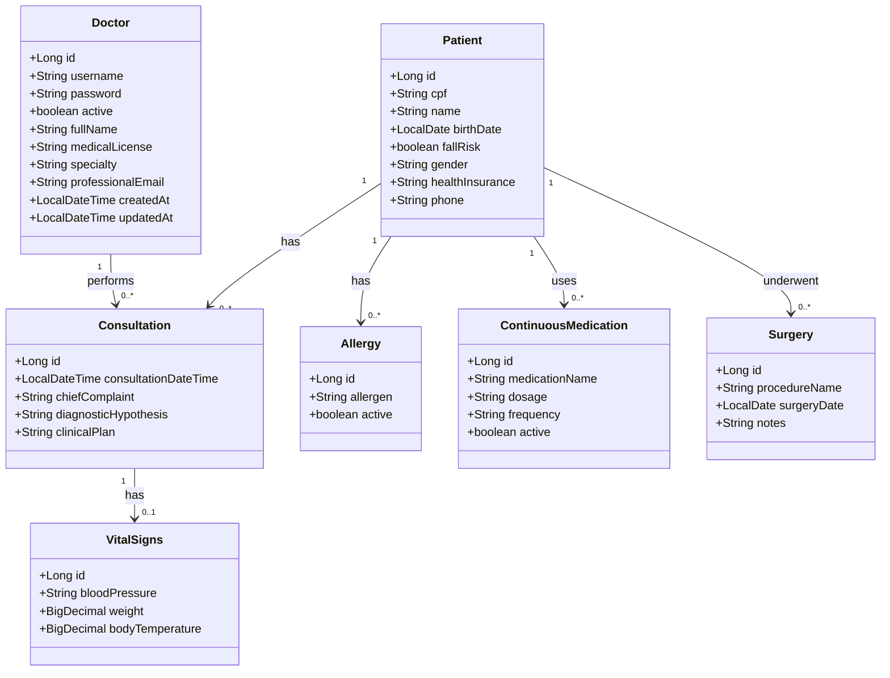

# Diagrama UML Inicial



## Termos clínicos

- `chiefComplaint`: queixa principal.
- `diagnosticHypothesis`: hipótese diagnóstica.
- `clinicalPlan`: conduta clínica.
- `bloodPressure`: pressão arterial.
- `bodyTemperature`: temperatura corporal.
- `fallRisk`: risco de queda.

## Relações

```text
Patient 1 ──── N Consultation
Doctor  1 ──── N Consultation
Consultation 1 ──── 1 VitalSigns
Patient 1 ──── N Allergy
Patient 1 ──── N ContinuousMedication
Patient 1 ──── N Surgery
```